<!-- ╔═══════════════════════  HEADER  ═══════════════════════╗ -->

**Backend Engineer**  
Java와 Spring을 중심으로 게임 서비스와 사내 플랫폼의 백엔드를 개발합니다.

---

### &nbsp;`ABOUT`

- Java와 Spring을 주로 사용하며 이벤트·쿠폰·보상·데이터 운영 서비스를 개발합니다.
- 업무에 필요한 경우 React/Vue 화면이나 C#/.NET 데스크톱 도구도 함께 만들었습니다.
- 개인 프로젝트에서는 Python과 LLM으로 영상과 문서를 지식 그래프로 정리하는 도구를 개발하고 있습니다.
- 기존 업무에서 반복되는 부분을 찾아 공통 기능이나 설정으로 옮기는 방식으로 설계합니다.

---

### &nbsp;`WHAT I'VE BUILT`

- **🎮 게임 라이브 서비스 백엔드**  
  이벤트·쿠폰·보상·리포트 기능을 개발했습니다. 플레이어가 참여하는 이벤트 게임 서버와 운영자가 사용하는 백오피스 기능도 맡았습니다.

- **🧩 이벤트 처리 로직 공통화**  
  이벤트마다 따로 만들던 처리 로직을 설정으로 운영할 수 있도록 공통 엔진으로 정리했습니다. 이벤트 유형별 처리 방식, 실패한 보상의 재처리, 분기형 설문, 여러 인증 수단을 사용하는 로그인 기능을 구현했습니다.

- **🔀 프런트엔드와 내부 API를 연결하는 서버**  
  프런트엔드 요청을 내부 API에 전달하고, 화면에서 쓰기 좋은 형태로 응답을 구성하는 API를 개발했습니다. 실시간 알림 처리와 문서 포털 정보 통합 기능도 맡았습니다.

- **🛠️ 개발·테스트 도구**  
  C#/.NET 기반 데스크톱 도구를 만들어 팀의 코드 검증과 테스트 과정을 자동화했습니다.

- **🧠 AI·지식 파이프라인 (개인 프로젝트)**  
  영상과 문서를 지식 그래프로 정리하는 파이프라인을 만들고 있습니다. 임베딩 기반 검색과 전사·OCR 자동화를 구현했고, 같은 입력에서 같은 결과가 나오도록 그래프 생성 과정도 구성했습니다.

---

### &nbsp;`STACK`

**Language**  

**Framework**  

**Data**  

**Infra**  

---

### &nbsp;`NOW`

- 개인 지식 그래프 파이프라인을 개발하고 있습니다.
- LLM 애플리케이션과 벡터 검색을 직접 실험하고 있습니다.
- 알고리즘과 자료구조도 꾸준히 공부합니다.

---

### &nbsp;`HOW I WORK`

---

### &nbsp;`CONTACT`

